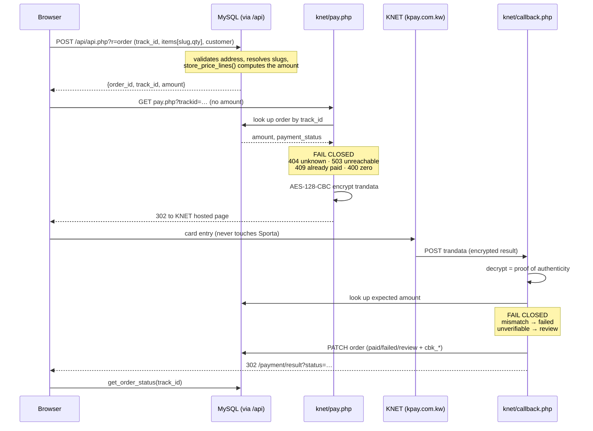

# KNET payments — full structure and plan

Everything about how Sporta takes money, in one place: what each piece does,
what the money path actually is, where the money-safety guarantees come from,
what is verified, and what is left to do.

Sporta uses **classic KNET (KPG)** — the AES-`trandata` model, native PHP on
Hostinger. Credentials come from the acquiring bank (CBK) as a **Tranportal**
set, not from KNET Co directly. The alternative CBK REST-JSON T-Pay model lives
in `sporta-web/dropin/php-cbk/` and is **not** what is deployed.

---

## 1. Structure

### 1.1 Where the code lives

| Path | Ships to | Role |
|---|---|---|
| `sporta-web/dropin/php-knet/knet.php` | `public_html/knet/` | Crypto + helpers. AES-128-CBC, HTTPS guard, order lookup, audit log. Never served (denied in `.htaccess`). |
| `sporta-web/dropin/php-knet/pay.php` | `public_html/knet/` | Starts a payment. Prices the order server-side, builds encrypted `trandata`, redirects to KNET. |
| `sporta-web/dropin/php-knet/callback.php` | `public_html/knet/` | Receives KNET's result. Decrypts, verifies, writes the order, redirects the customer. |
| `sporta-web/dropin/php-knet/config.example.php` | — | Template. |
| ~~`php-knet/api/index.php`~~ | — | **Does not exist.** This table listed a JSON API for the Flutter app; there is no such file and no `api/` directory under `php-knet/`. The Flutter skeleton in `sporta-app/` is unbuilt. Removed rather than left as a path someone goes looking for. |
| `config.php` | **server only** | Real credentials. Never committed, never in the zip, never uploaded, protected by the deploy keep-list. |
| `sporta-web/dropin/php-knet/setup-config.php` | `public_html/knet/` | CLI-only generator for `config.php`. **Delete after install.** |
| `sporta-web/dropin/php-knet/selftest.php` | `public_html/knet/` | Readiness check. **Delete after install.** |
| `sporta-web/dropin/php-knet/.htaccess` | `public_html/knet/` | HTTPS + canonical host, `no-store`, `noindex`, denies `config.php`/`knet.php`/`setup-config.php`/`*.log`. |
| `sporta-web/src/lib/checkout.js` | `dist/` | Browser side: calls `create_order`, then sends the customer to `pay.php`. |
| `sporta-web/src/pages/PaymentResult.jsx` | `dist/` | The page KNET's callback finally lands the customer on. |
| `sporta-web/dropin/php-store/*.sql` | `public_html/api/` | Order tables, the server-side pricing trigger, the catalogue seed and the brands. Import order in §3. |
| `sporta-web/dropin/php-store/store.php` | `public_html/api/` | `store_create_order()` — the shared checkout core both the shop and the gateways price from. |

`npm run release` bundles `dropin/php-knet/` into `dist/knet/`, excluding
`config.php`, so one deploy ships the site and the endpoints together.

### 1.2 The money path



### 1.3 Price authority — the core guarantee

**The browser never states a price, at any point.**

1. `create_order` takes only slugs, sizes and quantities — never a price.
   `store_price_lines()` reads each price from the `products` table and
   `store_discounts_for()` decides the discount; `api.php` then writes
   `orders.amount` from those figures inside the checkout transaction.

   > Earlier versions of this document said the amount was computed by
   > database triggers named `trg_set_item_price` and `trg_recompute_amount`.
   > **There are no triggers in this schema** — `information_schema.triggers`
   > returns zero rows after importing all four SQL files. The guarantee is
   > unchanged and just as strong, because the browser still never names a
   > price and the code that decides is on the server; but anyone auditing the
   > money path was being sent to look for something that is not there.
2. `pay.php` is called with **no `amount` parameter**. It reads the figure from
   the order it looks up.
3. `callback.php` re-reads the stored amount and compares it to what KNET says
   was captured.

Proven by decrypting real `trandata`: a browser asking for 0.100 produced a
KNET request for 24.000.

### 1.4 Fail-closed rules

| Where | Condition | Outcome |
|---|---|---|
| `pay.php` | order not found | **404**, no payment started |
| `pay.php` | database unreachable | **503** |
| `pay.php` | already paid | **409** (blocks double payment) |
| `pay.php` | amount ≤ 0 | **400** |
| `callback.php` | `trandata` missing / undecryptable | `?status=error`, nothing written |
| `callback.php` | captured amount ≠ stored amount | `failed` + `AMOUNT_MISMATCH` |
| `callback.php` | amount unverifiable (DB down, order gone, no `amt`) | **`review`** — never silently paid |
| `callback.php` | DB write fails after 1 retry | logged as `callback.db_write_failed` |
| `create_order` | unknown/inactive slug | `unavailable_<slug>` |

The `neq.paid` guard on the failure path means a replayed or late failure
callback can never un-pay a captured order.

### 1.5 Authenticity

Classic KPG has no HMAC header. Authenticity comes from the fact that
`trandata` is AES-128-CBC encrypted with the **Terminal Resource Key**, which
only the bank and the server hold. A payload that decrypts to well-formed
fields could only have been produced by someone holding that key. A callback
forged with any other key fails `knet_decrypt` and is rejected before anything
is read — verified in the test suite.

### 1.6 Order states

| `payment_status` | Set by | Meaning |
|---|---|---|
| `pending` | `create_order` | Created, not paid. Normal at redirect time. |
| `paid` | `callback.php` | Captured **and** amount verified. Only state that ships. |
| `failed` | `callback.php` | Declined, cancelled, or amount mismatch. |
| `review` | `callback.php` | Bank may have captured; the server could not verify. **Needs a human.** |
| `refunded` | `/backends` (§3e) | The whole payment went back by KPay Credit, recorded by the owner. Out of revenue. Final. |
| `voided` | `/backends` (§3e) | The transaction was voided in KPay before settlement, recorded by the owner. Out of revenue. Final. |

A **partial** refund leaves the order `paid` and is kept in `orders.refunded_amount`;
every revenue figure (dashboard, revenue chart, XBRL) is `amount - refunded_amount`.
No bank notification, replayed or late, can move a `refunded` or `voided` order
(both dropins hold it; §3e).

`fulfilment_status` (`unfulfilled → packed → shipped → delivered / cancelled`)
is separate and admin-driven.

### 1.7 Crypto specifics

Checked against KNET's official iPayPipe 1.0 plug-in (`com.fss.plugin`,
decompiled read-only; `sporta-web/KNET-IPAYPIPE-CHECK.md`), and built to send
what it sends:

- AES-128-CBC, PKCS5/7, key = Terminal Resource Key (**exactly 16 bytes** —
  `knet_assert_key` refuses anything else, because PHP would otherwise pad
  silently and KNET would reject every transaction with no useful error).
- **The IV is the resource key itself** (`AESAlgorithm.java:22` and `:44` build
  the `IvParameterSpec` from the key). There is no fixed IV: an older version of
  this section said `PGKEYENCDECIVSPC`, which appears nowhere in the plug-in;
  with it every first block decrypts to garbage at the bank.
- `trandata` hex-encoded, uppercase.
- The plaintext is **raw**: `key=value&` for every non-empty field, no URL
  encoding, empty fields not sent, in the plug-in's order (`iPayPipe.java:181-275`,
  then `id` and `password`, `:145-146`): `amt`, `action=1`, `responseURL`,
  `errorURL`, `trackid`, `udf5` (the order id), `currencycode=414` (KWD),
  `langid`, `id`, `password`. The bank's reader splits on `&` and `=` and decodes
  nothing (`:776-779`), so a value holding `&`, `=`, `?`, `#` or a control
  character is **refused** — on save in /backends and again before anything is
  sent — never encoded. (Until 2026-11-12 every value was URL-encoded, so
  `responseURL` reached the bank as `https%3A%2F%2F...`; D1.) `test:knet`
  rebuilds the plaintext independently and requires the same ciphertext.
- Success = `result` is `CAPTURED`, and only that. The plug-in judges nothing;
  `APPROVED` is not a purchase result and is refused (`callback.php`).
- Gateway: test `https://kpaytest.com.kw/kpg/PaymentHTTP.htm` or
  `https://www.kpaytest.com.kw/kpg/PaymentHTTP.htm`; production
  `https://kpay.com.kw/kpg/PaymentHTTP.htm` or `https://www.kpay.com.kw/kpg/PaymentHTTP.htm`.
  Exactly those strings, in `knet.php` and in the /backends save (D3); the
  plug-in takes the host from the bank's `<webaddress>`, which may be either.
- `langid`: `AR` for Arabic, `USA` for English. Sporta's values; the plug-in
  names no constant (`iPayPipe.java:263-265`). **To be confirmed on the first
  Arabic TEST payment**: the bank's page must come up in Arabic (D8).

### 1.8 Audit log

`knet_log()` writes append-only JSONL, `chmod 600` on creation, **outside**
`public_html`. Events: `pay.init`, `pay.reject`, `pay.error`,
`callback.received`, `callback.unverified`, `callback.amount_mismatch`,
`callback.db_write_failed`, and, when the inquiry is switched on (§3d),
`inquiry.request`, `inquiry.response`, `inquiry.unreachable`, `inquiry.settled`,
`inquiry.refused`. No secrets, no card data.

---

## 2. What is verified

| Suite | Covers |
|---|---|
| `npm run test:native` (36/36) | The `/api` contract itself: validation tokens, price authority, stock, invoices, brands, admin auth and its five-failure lock. |
| `npm run test:native-e2e` (20/20) | The built site in a real browser against real MariaDB — product page to order to invoice to the admin, every admin tab walked. |
| `npm run test:knet` (39/39) | The whole card path on the NATIVE backend against real MariaDB and a fake gateway that speaks the real Tranportal protocol (`scripts/fake-knet-bank.php`): the trandata this code encrypts is decrypted by an INDEPENDENT AES implementation in Node, the amount charged comes from the database and an `?amount=` in the URL is ignored, the callback answers `REDIRECT=` so a server-to-server gateway can bring the customer home, replays change nothing, underpayment/cancel/garbage all fail closed, and a captured card whose callback never arrived can be settled by an operator only with the bank's payment id. |
| `php -l` | All endpoints parse. |

Run them against a database built by importing `dropin/php-store/schema.mysql.sql`,
`seed.mysql.sql` and `brands.mysql.sql` in that order — the same order §3
documents, so the documented order is the one the tests actually exercise.

---

## 2a. The nomination letter — what the bank has actually issued

KNET Administration's "New Merchant Nomination" reply for
**AL MUHALLAB CO FOR DESIGNING AND PROGRAMMING SPECIAL SOFTWARE**,
CBK, **T-6261**, request ref. **6223**.

| | |
|---|---|
| Website registered | `https://www.sporta.com.kw` |
| Test Merchant ID | `6261` |
| Test Terminal ID | `626101` |
| Production Merchant ID | **not yet issued** |
| Production Terminal ID | **not yet issued** |
| Nominated features | Manual Refund, Batch Refund, Refund API, KFAST, ApplePay — Debit |

The registered website is exactly the canonical origin this codebase emits —
`www`, over HTTPS, one spelling. That is worth stating rather than assuming:
KNET validates the merchant site against what was nominated, and a bare-domain
or plain-HTTP spelling reaching the gateway is a rejected transaction rather
than a warning. Every `.htaccess` here already 301s the alternatives in a
single hop.

**Those two numbers are TEST-tier identifiers, not credentials.** The secrets —
the Tranportal password and the terminal resource key — are not in the letter
and are not in this repository; they come off the merchant portal and go only
into `knet/config.php` on the server. The production pair, when issued, is
subject to the same rule.

### The four things the letter says to do, and what each is for

1. **Tell KNET you are using the RAW toolkit.** The letter: *"If you are
   planning to use the RAW toolkits, then please inform us of the same so we
   can provide you with the RAW details."* This is the item to act on first,
   and it is the easiest one in the letter to read past.

   This shop does not use KNET's downloadable plugin. `knet.php` builds and
   AES-128-CBC-encrypts `trandata` itself against the raw KPG endpoint — that
   IS the raw integration, and it is why the card path is 39 tested checks of
   our own code rather than a vendor jar. So the RAW details have to be
   requested explicitly. Without them, the key and endpoint parameters handed
   over are the plugin's, and the plugin is not what is deployed.

2. **Resource file / keystore download** (Merchant Process → Resource File
   Download, both links). These are the plug-in's files: `keystore.bin` (a
   JCEKS store) and `resource.cgn` (the terminal XML, encrypted twice). They
   give nothing that can be typed: the plug-in decrypts them to exactly
   Sporta's four values, `<id>`, `<password>`, `<resourceKey>` and
   `<webaddress>` (`ParseResouce.java`, `iPayPipe.java:142-147`). Ask KNET for
   those four in plain text (the RAW details, item 1). **Keep the two files off
   the server and out of the repository, and delete them once the values are
   in /backends**: the keystore password and alias are the same in every copy
   of the plug-in, so the files are as sensitive as the plain credentials
   (D10). Both `.htaccess` files deny `keystore.bin`, `*.cgn` and `*.cgz`, and
   `scripts/file-audit.mjs` / `scripts/unknown-files-scan.mjs` flag them.

3. **Alias name** (Merchant Process → View Terminal → View → Plugin tab). The
   alias names a key inside the plugin's Java keystore. A RAW integration has
   no keystore, so this is a *plugin* value with no slot in `config.php` —
   note it down, but do not go hunting for where to paste it.

4. **Certification test before production.** The production IDs are blank in
   the letter because they are issued after certification, not before. So P0
   step 6 — "switch `env` to `production`" — cannot happen yet, however ready
   everything else is. The test path (`kpaytest.com.kw`, Merchant 6261 /
   Terminal 626101) is the only one that exists today.

### Which number is the Tranportal ID — confirm, do not assume

`config.php` wants `tranportal_id` + `tranportal_password`. The letter gives a
Merchant ID and a Terminal ID, and neither is labelled "Tranportal". In CBK's
usual arrangement the Tranportal ID is the **terminal**-level credential —
`626101` — with `6261` identifying the merchant above it. That is the likely
mapping and it is still a guess, so put the question in the same email as the
RAW request rather than discovering the answer as a failed test transaction.

### Nominated ≠ built

Four of the five nominated features have no implementation here, and switching
them on at the bank does not create one:

- **Manual Refund / Batch Refund / Refund API** — already logged as P2 item 7.
  The shop never sends `action=2` (credit) or void to KNET, so a refund is still
  a KPay portal operation. What the shop does now is RECORD that portal refund or
  void in `orders` (§3e, `/backends`). The Refund API being nominated is what
  would make the shop issue refunds itself.
- **KFAST** — KNET's saved-card flow. It adds fields to `trandata` and a token
  to store against the customer. Nothing here does that, and it should not be
  bolted on casually: a stored payment token is the one piece of this system
  whose loss costs a customer money rather than an order.
- **ApplePay — Debit** — needs an Apple merchant identity and a domain
  association file served from `/.well-known/`. That path is already exempt
  from the dotfile deny rule in `public/.htaccess` (the exemption exists for
  ACME renewal), so the file would be reachable; everything else is unbuilt.

None of this blocks going live with the card path. All four are things the
bank now believes this merchant can do.

---

## 3. Plan

### P0 — before any live payment

0. **Email KNET: RAW toolkit, and which number is the Tranportal ID.** See
   §2a. Everything below assumes the four values in plain text (Tranportal ID,
   password, 16-byte resource key, gateway address); the plug-in's download
   holds the same four but encrypted (§2a item 2), and the letter only hands
   over the RAW details on request. This step gates steps 3 and 5.
1. **Import the SQL** — one file: phpMyAdmin → Import → `api/install.mysql.sql`.
   It is the four part files concatenated in dependency order by
   `scripts/make-install-sql.mjs`, so there is no order to get wrong. Verified
   against a fresh database: importing it once produces a schema
   byte-identical to running the four by hand, and importing it twice changes
   nothing. The parts still ship for re-running one on its own.
2. **Confirm the catalogue loaded.** `seed.mysql.sql` does it; Backends →
   Catalogue → Push products is the browser equivalent. Orders price from that
   table, and empty means every checkout is refused.
3. **Create `config.php`** in hPanel File Manager from `config.example.php`
   (SSH is off, so `setup-config.php` is not available to this host).
4. **Register `https://www.sporta.com.kw/knet/callback.php`** with the bank as
   both `responseURL` and `errorURL`.
5. **Test transaction** on `env: 'test'` against `kpaytest.com.kw` — a real
   0.100 KWD payment returning `CAPTURED`. Confirm the order flips to `paid`
   in the admin, not just that the browser showed a tick.
6. **Switch `env` to `production`** with production credentials, repeat once.
   Blocked until KNET's certification test is passed — the production Merchant
   and Terminal IDs do not exist before it (§2a).
7. **Delete `setup-config.php` and `selftest.php`** from the server.

**One page answers "is step N done?"** — `https://www.sporta.com.kw/api/preflight.php`,
unlocked with the `cron_key` from `api/config.php`. It shows the lowest
unfinished step and nothing else, and for KNET it now goes past "are the keys
filled in":

- opens the orders database with **`knet/config.php`'s own** `mysql_*` values
  and reads the `orders` table — four non-empty keys that do not actually work
  is the documented way to get "Invalid amount" on every card;
- checks that database is the **same one** `api/config.php` names, because two
  valid databases means the gateway looks for an order the shop wrote
  elsewhere;
- **encrypts and decrypts a probe with the real `resource_key`** through
  `knet.php` itself — 16 bytes of the wrong thing is still 16 bytes;
- flags **invisible characters** (leading/trailing space, NBSP, zero-width
  space, BOM) in any credential, which File Manager renders as nothing at all;
- refuses a `test_url` pointing at the production host while `env` is `test`,
  which is a rehearsal run with real cards;
- reads `knet/.htaccess` and confirms it actually **denies** `config.php` and
  `knet.php`, rather than merely existing.

`npm run test:preflight` breaks the install in each of those ways and asserts
the page names it, and that no secret is ever printed.

> Item 5 is the one that matters. A green result page proves the redirect
> worked; only the admin row proves the money was recorded. That distinction is
> exactly what the column-name bug hid.

### P1 — the remaining money-safety gap

**Abandoned callbacks.** Classic KPG is redirect-only: there is no
server-to-server webhook. If the customer closes the browser after the bank
captures but before the redirect fires, `callback.php` never runs, and the
order stays `pending` while the money is gone. Nothing in the current design
detects this.

Recommended, in order:

1. **Stale-pending alert in the admin** — surface orders `pending` for more
   than ~30 minutes. Cheap, and it turns a silent loss into a visible queue.
2. **Daily reconciliation** — compare the KNET settlement report against
   `orders`, flagging captured-but-not-`paid` and `paid`-but-not-settled.
3. **Payment inquiry** — BUILT, OFF by default (§3d): the stock sweeper asks
   `tranPipe.htm` about a pending KNET order before releasing it. Needs KNET's
   answers to the questions in §3d before it is switched on.

Also P1:

4. **Alert on `callback.db_write_failed`.** Today it only reaches a log file
   nobody watches; it means money was taken and not recorded.
5. **Work the `review` queue.** The status exists and the admin counts it;
   there is no defined procedure for clearing one.

### P2 — completeness

6. **Order confirmation** to the customer on `paid` (email/WhatsApp). Nothing
   is sent today. Needs the SPF/DKIM/DMARC records in `DNS-EMAIL-RECORDS.txt`
   first, or it lands in spam.
7. **Refunds / voids by the shop.** Not built: the shop never sends `action=2`
   (credit) or a void to KNET. A refund or void done in the KPay portal is
   recorded in `orders` from `/backends` (§3e); it is not issued from the shop.
8. **Log rotation** for the JSONL audit file.
9. **Receipt** — `cbk_receipt` and `cbk_paytype` are now captured but unused.

### Explicitly not planned

- **Storing card data.** Card entry stays on the bank's hosted page. This is
  what keeps Sporta out of PCI-DSS scope. Do not add an on-site card form.
- **`php-cbk/` (T-Pay REST-JSON).** A second, unused integration path. Keep it
  dormant unless the bank migrates the account.

---

## 3a. Pointing the card path at the orders database

`knet/config.php` has to be TOLD which database holds the orders — it is a
separate file from `api/config.php` and shares nothing with it automatically:

```php
'mysql_host' => 'localhost',
'mysql_name' => '...',   // the same database as api/config.php,
'mysql_user' => '...',   // where these four keys are spelled db_*
'mysql_pass' => '...',
```

Leave them blank and `pay.php` has no amount to charge: every card is refused
with `400 Invalid amount` and every captured payment goes unrecorded. That is
not hypothetical — it is what happened, and `npm run test:knet` exists because
of it.

Without it the whole card path is dead, and silently: `knet_db_configured()`
answered "no database", so `pay.php` refused every payment with **400 Invalid
amount** (the storefront sends no amount, by design — the price must come from
the server) and `callback.php` skipped the write entirely, leaving the MySQL
branch inside it unreachable and every captured payment unrecorded. Both are
fixed and both are now covered by `npm run test:knet`; `knet/selftest.php`
reports the database it will use, and says so loudly when there is none.

## 3b. How the customer gets home — confirm this with the bank

KPG has two deployment styles and the merchant cannot tell which one an
account has been given:

* the gateway **redirects the browser** to `responseURL`; or
* the gateway calls `responseURL` **server to server** and reads the token
  `REDIRECT=<url>` out of the reply, then sends the browser there itself.

A plain HTTP 302 is correct for the first and useless for the second — the
shopper is left on a blank bank page with the money taken. `callback.php`
therefore answers BOTH at once by default (`'callback_response' => 'both'`):
HTTP 200, `REDIRECT=<url>` on the first line, then a meta refresh and a link.
Set it to `'redirect'` only if the bank confirms the browser-redirect style.

**This is the one thing to ask CBK when the account goes live.**

## 3c. When the bank took the money and never told us

KPG reports through the customer's browser, so a closed tab loses the message:
the money is captured and the order sits at `pending` (or `review`, where the
callback parks anything it could not verify). This cannot be designed away — it
is inherent to a browser-delivered result.

The admin's order drawer therefore has a settle control for card orders, and it
demands the **KNET payment id** typed in from the KNET portal. That is the
forcing function: it cannot be filled in without having looked the transaction
up. The order is recorded as `MANUAL_BANK_CONFIRMED`, never as a bank callback,
so a manual settlement is always distinguishable when the books are read. Cash
orders keep their own control and cards still cannot be settled on a hunch.

Once KNET has answered the questions in §3d, the stock sweeper can ask the bank
itself before it releases such an order (the inquiry, OFF by default).

## 3d. Inquiry — asking the bank about a lost callback (built, OFF)

KNET-IPAYPIPE-CHECK.md D2. The plug-in's only server-to-server call is
`performTransaction` (`iPayPipe.java:277-314`): a plain XML `<request>` POSTed as
`application/xml` to `<webaddress>/tranPipe.htm?param=tranInit` with the Tranportal
id and password inside (`iPayTransactionPipe.java:13-17`), answered with flat
`<tag>value</tag>` pairs (`parseResult`, `:575-742`). `knet_inquire()` in
`knet/knet.php` sends exactly that shape: `[<transid>]<amt><action><trackid>[<udf5>]
<currencycode>414</currencycode><id><password><errorURL><responseURL>`, TLS 1.2 with
certificate and host verification on, 10 s time-out, the plug-in's `<currency>`=amount
bug NOT copied.

**What it does.** `api/cron-stock.php` (every 15 min on the VPS) asks about each
pending KNET order BEFORE it releases the stock, once per reference the order was
sent under (attempt 1 to `pay_attempt`: `<order>`, `<order>A2`, ...). A `CAPTURED`
answer for exactly that reference goes through `knet_settle_order`, the callback's
own function, under the same row lock and guards: **paid** when the amount matches
(the warehouse gets its "ship it" once), **review** when it does not (stock kept),
nothing if already settled. Anything else (NOT CAPTURED, an error, another
reference echoed, NO reference echoed, no answer) leaves the sweeper doing what it
did before. **One payment, one order** (review fix): the answer must resolve back
to the order asked about exactly as the callback resolves one (`knet_resolve_track`,
the echoed `udf5` first), because track ids are chosen by the browser and order X's
first reference can be the same string as order Y's retry reference (`<Y>A2`); and
the settlement refuses to mark an order paid when another KNET order already
records the same Payment ID (`payment_id_in_use`, held for review). Both checks
also run for the callback (the second one) and are in `npm run test:knet`. If the
bank does not answer (time-out, 5xx), the run stops asking after that one
question. `--check` asks nobody. The settlement runs on the KNET database
connection, which already holds the callback's grants.

**Switching it on** (`knet/config.php`, i.e. `knet-config.php` on the VPS):

```php
'inquiry_enabled' => true,
'inquiry_action'  => '<the inquiry action code KNET gives>',   // no default: unset = refused
// only if KNET says the inquiry needs them:
'inquiry_transid' => 'trackid',   // sends <transid><reference></transid>
'inquiry_udf5'    => '<word>',    // sends <udf5><word></udf5>
```

Unset `inquiry_action` refuses the whole inquiry (logged as `inquiry.refused`,
reported in the sweeper's JSON as `knet_inquiry.refused`). Codes that move money in
this plug-in family's numbering (1 purchase, 2 credit, 3 void, 4 authorization,
5 capture, 6, 7, 9 voids) are refused whatever the config says.

**Questions for KNET (ask in the RAW-details email, before switching it on):**

1. Is `tranPipe.htm` inquiry enabled for terminal 626101 (TEST) and, later, the
   production terminal? Which **action code** is an inquiry?
2. Which field names the transaction to look up: `trackid`, `transid` (and is it
   the track id or the payment id), and does `udf5` select the lookup type?
3. Which **response fields** come back (`result`, `amt`, `payid` or `paymentid`,
   `tranid`, `ref`, `auth`, `trackid`, `udf5`), and which `result` words: is `CAPTURED`
   the only success word, and what does an unknown reference return? The shop
   settles only an answer that echoes the `trackid` it asked about, and uses the
   echoed `udf5` (the order id `pay.php` sent) to tell look-alike references apart:
   does the inquiry answer echo both?
4. Must the server's IP **187.7.78.123** be whitelisted for `tranPipe.htm`?
5. Is the inquiry host the same `<webaddress>` as the hosted page (bare or `www.`)?

`npm run test:knet` covers it against the fake bank's `/tranPipe.htm`: off by
default, refused without an action, settled on a capture at attempt 2, review on a
wrong amount, released on NOT CAPTURED / another reference / no answer, one
question when the bank is down, a self-signed certificate refused, and no
Tranportal password in the log.

**Mutations, committed (review fix):** `npm run test:knet-mutants` (`scripts/knet-mutants.mjs`)
re-runs every money-path mutation of the plug-in match (P1), the payment records (P2) and the
review fixes (R): each breaks one rule, runs the suites that should catch it, and must make one
fail; the files are restored after each. `MUTANTS_DRY=1` only checks that every mutant still
applies. It waits 3 s around each edit: `php -S` serves PHP through opcache with
`revalidate_freq = 2`, so an edit less than 2 s old can still be served as the ORIGINAL code (the
cause of the mutants that "survived a combined pass and were killed alone").

## 3e. Refunds and voids made in KPay (built, ships with the API release)

KNET-K063-CHECK.md B1, B2, B8, B9, B10. The shop never sends a credit or a void
(it only ever sends action 1, purchase); KPay's **Credit** and **Void** are
buttons a person presses in the merchant portal (K-063 §4.1, §4.2), and the bank
does not tell the shop. So the owner does it in KPay, then **records** it in
`/backends`: open the order, section **KNET payment**, "Record a refund or void
made in KPay". Code: `api/payment-records.php` (routes `knet_payment_record`,
`knet_refund_record`); database: `refunds.mysql.sql` (import it before the PHP).

**The rules (the server's; the screen only draws them):**

* KNET orders only, `paid` or `review` (for the order's own payment; an open
  second charge, §3f, can be recorded whatever the order's status, including
  after the order's own refund or void). The **KNET Payment ID must be typed**
  from KPay and must be the order's own (or an open second charge's, §3f): the
  same forcing function as manual settlement, and it stops a refund of one
  payment being booked against another order.
* **Void** = the whole payment, never part of it, and never after a refund.
* **Refund** = all of it or **part** of it. Decision: partial refunds are
  recorded with their amount. They leave the order `paid` (the customer keeps the
  order; the warehouse hears nothing) and lower its revenue. Refunds that add up
  to the whole payment make the order `refunded`. Nothing can exceed what was paid.
* A **review** order (a capture the shop could not verify) is closed whole, with
  the amount KPay gave back (it is often not the order's amount: that is usually
  why it is under review), never more than the order's amount
  (`refund_exceeds_payment`).
* **The whole payment back, order not shipped yet** (unfulfilled or packed): the
  order is cancelled, the warehouse gets "CANCELLED - do not ship" (the outbox's
  `cancel` kind, the same as an admin cancel), its garments and discount uses go
  back (`store_stock_release`, the cancelled-order path), and the customer's
  tracking shows the cancellation. **Shipped or delivered**: only the payment is
  re-marked; the goods come back through Returns and a stock `return` adjustment.
* One submission, one record: each form carries a request key; a double click or
  a retry after a lost answer is answered as a replay. Each record keeps who made
  it, the KPay reference (optional) and a note, and is an admin activity event.
* A refunded or voided order cannot be put back on (`order_refunded`), settled
  by hand, or made paid by a late or replayed bank notification (KNET and the
  CBK callback both hold it).

**Runbook, every refund or void:**

1. If the order has **not shipped** and the warehouse may already have the
   picking list, phone them first; the do-not-ship e-mail follows on its own.
2. KPay: Transaction > **Order List** (Order Status PROCESSED, click the Payment
   ID) or **Posted Transactions** (Terminal ALL, the Merchant Track ID: the order
   number, or `<order>A2`..`A10` for a retry; /backends lists every one the order
   was sent under). Choose **Credit** (refund; change the amount for a partial
   one) or **Void**. Note KPay's reference for it.
3. `/backends` > Orders > the order > KNET payment: Refund or Void, type the
   Payment ID from KPay, the amount, the KPay reference, tick "I have made this
   ... in the KPay portal", Record. Tell the customer.

## 3f. A customer charged twice (built, ships with the API release)

K-063 B3 / C1. A CAPTURED notification (or inquiry answer) for an order that is
already paid, under a **different** Payment ID, is a second charge. It used to be
answered `already_paid` with only a log line. Now `knet_settle_order` keeps it as
a `payment_alerts` row (one per extra Payment ID, so its own replay is a no-op),
logs `callback.duplicate_capture`, and leaves the order exactly as it was (still
paid, its own Payment ID, no second "ship it"); the shopper is still shown the paid
order. The same Payment ID replayed stays a silent no-op. A capture parked for
review that a later capture overwrites is kept as an alert too, and a capture
after a recorded refund or void is one. There is no other alert channel for
payments: the alert shows on the **Orders** screen ("KNET checks") and in the
order's drawer.

**Runbook:** confirm the two charges in KPay (two PROCESSED rows for one order's
references), **refund the extra one** in KPay, then record it in the order's
drawer with **the extra Payment ID** and its full amount (the order stays paid and
its revenue unchanged; the alert closes as refunded). If KPay shows only one
charge, press **Dismiss** (the alert closes as dismissed, with who did it).

**An order settled by hand** (/backends "settle card payment" stores the typed bank
reference as its Payment ID) whose bank notification arrives later is NOT a second
charge: when the amount is the order's and no other order holds that Payment ID,
the bank's own fields replace the typed reference (`cbk_status`
`MANUAL_THEN_CAPTURED`, logged `callback.manual_settlement_confirmed` with the typed
reference), and no alert is raised. A capture under yet another Payment ID after
that is a second charge again. The one case this cannot tell apart (settled by
hand, the first payment's notification lost for good, and a real second charge
notified) shows in the daily check (§3h): two PROCESSED rows in KPay, one Payment
ID in the export.

## 3g. The customer's receipt (built, ships with the API release and sporta-features.js)

K-063 D1/D5 and the owner's UAT receipt spec (KNET-K063-CHECK.md). The result page
shows the bank's answer as a receipt: result, amount, date and time of the payment
(Kuwait time), Payment ID, Transaction ID, Track ID (the Merchant Track ID the bank
answered under, `orders.gateway_attempt_ref`), reference number, auth code and the
order number, in Arabic and English. **Every value is the order row's**, from
`api.php?r=status`, and only for the order's own shopper: the callback adds a
**receipt key** (`k`, 7 days, its own HMAC domain) to the redirect on the bank's
authenticated leg, and only when the order now records THAT trandata's Payment ID
(the payment that paid it, or the decline that failed it). It opens the bank
fields of `?r=status` and nothing else: `?r=invoice` never accepts it, so it shows
no name, phone or address. (Review fix: it used to be the invoice key, issued for
any result, and anyone can start the bank leg for any pending order with its
track id alone and press Cancel.) The status route also takes the invoice route's
proofs (the invoice key issued with a new order, the checkout phone, the
signed-in owner). The full invoice carries the same fields. The page takes `k`
out of the address bar at once (`history.replaceState`) and keeps it in that
tab's sessionStorage, so a shared or screenshotted address carries no key.
The redirect also carries the language saved on the order (`lang`). The errorURL
leg keeps the order number and Payment ID, but names the order **`order=`**, not
`trackid=`: the compiled page reads `trackid` and calls a pending order "Payment
received ... Do not pay again", so only the add-on reads `order`. That makes the
API release safe in either deploy order; deploy `sporta-features.js` and
`sporta-shadows.css` with it or first all the same, since without them the
shopper sees the compiled page's "Something went wrong" (as before). The live result page is the
compiled build; the receipt is the PAYMENT RECEIPT block of `sporta-features.js`
(+ RECEIPT-1112 in `sporta-shadows.css`, which reserves its height), which also
stops the compiled page telling a shopper who paid nothing "Do not pay again"
(unknown order, pending, a failed status check). Needs `cron_key` in the store
config (the key's secret); without it the receipt shows the order and amount only.

## 3h. Daily KPay reconciliation (C2)

K-063 has no "settlement report"; these are the reports it does have (§5). Do it
once a day for the day before, from **test** first, then from the first
production payment (write down the switch date).

1. **KPay**: Reports > Transaction Reports > **Transaction Detail Report**,
   terminal (626101 on test), Download Type **CSV**, View Type **Extend View**,
   yesterday. On the first test payment, write down: the time zone of
   "Transaction Date And Time", Current vs History, the Result Code words for a
   success, a decline and a cancel, and the Action values (purchase, credit, void).
2. **Sporta**: `/backends` > Orders > **KNET checks** > Daily KPay check: the same
   day, **Kuwait days** (or UTC days if step 1 showed KPay reports in UTC),
   Download CSV (`admin.php?r=knet_reconcile_export`). One row per KNET order with
   anything that day (placed, paid, refunded, or a second charge): every Merchant
   Track ID it was sent to KNET under, the one it was answered under, Payment ID,
   Transaction ID, reference, auth code, amounts (paid, refunded, net), the bank's
   result, paid time in UTC and Kuwait time, refunds and voids, second charges.
   No customer name or phone.
3. **Match** each KPay row to a Sporta row by **Merchant Track ID** (the Sporta
   column lists all of an order's references) and check the Payment ID and amount.

| What you see | What it means | What to do |
|---|---|---|
| KPay CAPTURED, Sporta `paid`, same Payment ID and amount | normal | nothing |
| KPay CAPTURED, Sporta `pending` (no Payment ID) | the callback never arrived | check the Merchant Track ID, amount and terminal belong to the order, then settle it in the drawer with the Payment ID (§3c) |
| KPay CAPTURED, Sporta `review` | the shop could not verify (amount, stock, cancelled) | decide: settle by hand, or refund in KPay and record it (§3e) |
| KPay CAPTURED, Sporta `failed` or `cancelled` | money taken on a closed order | refund in KPay, record it (§3e); tell the customer |
| Two KPay CAPTURED rows for one order | a second charge | refund the extra one, record it with its Payment ID (§3f); /backends should already show the alert |
| KPay CAPTURED with no Sporta row at all | a K-Link payment or another channel | check K-Link (K-063 §6); nothing in the shop to settle |
| Sporta `paid`, nothing in KPay that day | the time-zone window, or test vs production | widen the window by a day; check the terminal |
| KPay Credit or Void, Sporta still `paid` (or the amount differs) | a refund not recorded | record it in the order (§3e) |
| Sporta `refunded`/`voided`, no Credit or Void in KPay | recorded but not done | do it in KPay now, or correct the record with the owner |
| Amount differs on a CAPTURED row | partial payment or a wrong order | the order is in review; compare and decide as above |

4. **Totals**: KPay **Transaction Summary** (success count and amount for the
   day) against the CSV's CAPTURED rows: the gross "Amount KWD" of the rows whose
   "Paid (Kuwait)" falls on that day, including `review` rows that carry a
   CAPTURED answer. Compare KPay's Credit and Void amounts for the day with the
   refund rows dated that day (the "Refunds and voids" list), not with "Net KWD":
   "Net KWD" is 0 for a fully refunded order, so a same-day refund would appear
   to disagree.
   The `/backends` dashboard revenue mixes all payment methods and counts days in
   UTC, so use the CSV, not the dashboard.

---

## 4. Failure runbook

| Symptom | Cause | Action |
|---|---|---|
| `404 Unknown order` at Pay | `schema.mysql.sql` not imported, or the order was never created | Import the SQL |
| `Order has no payable amount` | `products` table empty | Admin → Catalogue → Push products |
| KNET rejects every transaction | `resource_key` not exactly 16 bytes | `knet/selftest.php` names it |
| Every card refused with `400 Invalid amount` | no `mysql_*` values in `knet/config.php` | Fill them in — see §3a |
| Customer sees success, order stays `pending` | `callback.db_write_failed` in the log | Check the log; fixed for the column-mismatch cause |
| Order stuck at `review` | Amount could not be verified | Compare against KPay by `cbk_paymentid`; settle it by hand, or refund it in KPay and record it (§3e) |
| /backends shows "a second KNET charge" | a customer was charged twice (§3f) | Refund the extra Payment ID in KPay, record it in the order's drawer |
| Refund screen says `refunds_migration_missing` | `refunds.mysql.sql` not imported | Import it (additive, idempotent) |
| `503` at Pay | the orders database is unreachable | Correct — no payment starts. Check the `mysql_*` values and that MySQL is up |
